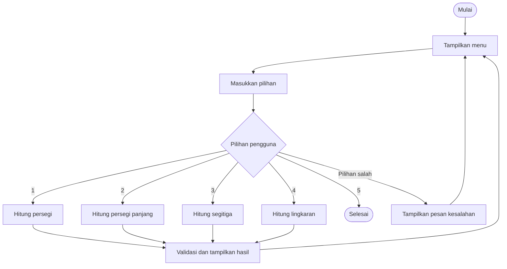

# Proposal Proyek Pertemuan 14: Kalkulator Geometri Bangun Datar

| **Keterangan** | **Data** |
|---|---|
| **Nama** | Azizah Nur Kholishah |
| **NIM** | 2225250116 |
| **Kelas** | 3-E |

Mata Kuliah Algoritma dan Pemrograman, Pertemuan 14, S1 Pendidikan Matematika FKIP Universitas Sultan Ageng Tirtayasa, Tahun Akademik 2026/2027 Ganjil.

Proyek dikerjakan secara individu.

---

## 1. Judul Proyek

**Kalkulator Geometri Bangun Datar** menggunakan bahasa pemrograman Python berbasis console/terminal.

## 2. Latar Belakang dan Masalah

Bangun datar merupakan salah satu materi dalam pembelajaran matematika yang mempelajari bentuk, luas, dan keliling suatu bidang. Dalam mempelajari materi tersebut, siswa perlu memahami rumus dan melakukan perhitungan dengan tepat.

Namun, siswa terkadang mengalami kesulitan dalam mengingat rumus dan melakukan perhitungan luas maupun keliling bangun datar. Oleh karena itu, diperlukan program sederhana yang dapat membantu pengguna melakukan perhitungan secara lebih mudah dan cepat.

Program Kalkulator Geometri Bangun Datar dibuat menggunakan Python untuk menghitung luas dan keliling beberapa bangun datar melalui pilihan menu pada terminal.

**Pernyataan masalah:**

Bagaimana membuat program sederhana yang dapat menghitung luas dan keliling bangun datar berdasarkan ukuran yang dimasukkan pengguna serta menampilkan hasil perhitungannya secara otomatis?

## 3. Pengguna dan Tujuan

**Pengguna utama:** Siswa yang sedang mempelajari materi geometri bangun datar.

**Tujuan:**
- Membantu pengguna menghitung luas dan keliling bangun datar.
- Mempermudah penerapan rumus matematika dalam perhitungan.
- Melatih pemahaman penggunaan program Python dalam menyelesaikan permasalahan matematika.

**Manfaat:** Pengguna dapat melakukan perhitungan luas dan keliling secara lebih praktis serta memperoleh hasil secara otomatis.

**User story:** Sebagai siswa yang sedang mempelajari bangun datar, saya ingin menggunakan kalkulator geometri agar dapat menghitung luas dan keliling dengan lebih mudah.

## 4. Ruang Lingkup

Program hanya mencakup empat jenis bangun datar, yaitu:

1. Persegi.
2. Persegi panjang.
3. Segitiga.
4. Lingkaran.

**Fitur wajib:**
1. Menghitung luas dan keliling persegi.
2. Menghitung luas dan keliling persegi panjang.
3. Menghitung luas dan keliling segitiga.
4. Menghitung luas dan keliling lingkaran.
5. Memvalidasi input agar ukuran bangun datar lebih dari nol.
6. Menampilkan hasil perhitungan kepada pengguna.

**Batasan proyek:**
- Program dijalankan melalui terminal atau console.
- Menggunakan bahasa pemrograman Python 3.
- Tidak menggunakan GUI atau aplikasi berbasis web.
- Tidak menggunakan database.
- Perhitungan dibatasi pada empat bangun datar yang telah ditentukan.

## 5. Kebutuhan Program

### Kebutuhan Fungsional

| ID | Kebutuhan | Fungsi Terkait |
|---|---|---|
| F01 | Program menampilkan menu bangun datar | `menu()` |
| F02 | Program menghitung luas dan keliling persegi | `hitung_persegi()` |
| F03 | Program menghitung luas dan keliling persegi panjang | `hitung_persegi_panjang()` |
| F04 | Program menghitung luas dan keliling segitiga | `hitung_segitiga()` |
| F05 | Program menghitung luas dan keliling lingkaran | `hitung_lingkaran()` |
| F06 | Program memvalidasi input pengguna | Pemeriksaan pada `main()` |
| F07 | Program menampilkan hasil perhitungan | `main()` |

### Kebutuhan Nonfungsional

- Program dapat dijalankan melalui terminal VS Code.
- Menggunakan Python 3 tanpa library tambahan selain library standar.
- Tampilan menu dan hasil mudah dipahami.
- Nama fungsi dan variabel mudah dikenali.
- Program dapat dijalankan dan diuji kembali.

## 6. Input–Proses–Output (IPO)

| Bangun Datar | Input | Proses | Output |
|---|---|---|---|
| Persegi | Sisi | Luas = s × s; Keliling = 4 × s | Luas dan keliling |
| Persegi panjang | Panjang dan lebar | Luas = p × l; Keliling = 2 × (p + l) | Luas dan keliling |
| Segitiga | Alas, tinggi, dan tiga sisi | Luas = ½ × alas × tinggi; Keliling = a + b + c | Luas dan keliling |
| Lingkaran | Jari-jari | Luas = π × r²; Keliling = 2 × π × r | Luas dan keliling |

## 7. Algoritma Program

### Pseudocode

```text
MULAI

Tampilkan menu bangun datar

ULANGI:
    Terima pilihan pengguna

    JIKA pilihan = 1:
        Masukkan sisi
        Validasi sisi
        Hitung luas dan keliling persegi

    JIKA pilihan = 2:
        Masukkan panjang dan lebar
        Validasi input
        Hitung luas dan keliling persegi panjang

    JIKA pilihan = 3:
        Masukkan alas, tinggi, dan tiga sisi
        Validasi input dan syarat segitiga
        Hitung luas dan keliling segitiga

    JIKA pilihan = 4:
        Masukkan jari-jari
        Validasi jari-jari
        Hitung luas dan keliling lingkaran

    JIKA pilihan = 5:
        Tampilkan pesan keluar
        HENTIKAN PROGRAM

    JIKA pilihan tidak tersedia:
        Tampilkan pesan kesalahan

    Tampilkan hasil jika perhitungan berhasil

SELESAI ULANGI

SELESAI
```

### Diagram Alur



## 8. Struktur Program dan Folder

### Fungsi Program

| Fungsi | File | Tanggung Jawab |
|---|---|---|
| `menu()` | `src/main.py` | Menampilkan menu pilihan |
| `hitung_persegi()` | `src/perhitungan.py` | Menghitung luas dan keliling persegi |
| `hitung_persegi_panjang()` | `src/perhitungan.py` | Menghitung luas dan keliling persegi panjang |
| `hitung_segitiga()` | `src/perhitungan.py` | Menghitung luas dan keliling segitiga |
| `hitung_lingkaran()` | `src/perhitungan.py` | Menghitung luas dan keliling lingkaran |
| `main()` | `src/main.py` | Mengatur alur utama program |

### Struktur Folder

```text
kalkulator-geometri/
|-- README.md
|-- proposal.md
|-- .gitignore
|-- src/
|   |-- main.py
|   `-- perhitungan.py
|-- tests/
|   |-- test_case.md
|   `-- test_program.py
`-- output/
    `-- .gitkeep
```

Program dibagi menjadi dua file utama agar bagian menu dan proses perhitungan tidak tercampur. File `main.py` mengatur alur program, sedangkan `perhitungan.py` menyimpan fungsi perhitungan setiap bangun datar.

## 9. Struktur Data

| Struktur Data | Penggunaan | Alasan |
|---|---|---|
| Variabel | Menyimpan input ukuran bangun datar | Menyimpan nilai yang dimasukkan pengguna |
| String | Menyimpan pilihan menu | Menerima pilihan pengguna |
| Float | Menyimpan ukuran dan hasil perhitungan | Mendukung bilangan desimal |
| Tuple | Mengembalikan luas dan keliling | Mengembalikan dua hasil dari satu fungsi |

Contoh penggunaan:

```python
sisi = 5.0
luas, keliling = hitung_persegi(sisi)
```

## 10. Test Case

Pengujian dilakukan untuk memastikan setiap fitur berjalan sesuai dengan hasil yang diharapkan.

| ID | Pengujian | Input | Hasil yang Diharapkan |
|---|---|---|---|
| TC01 | Persegi | Sisi = 5 | Luas = 25, keliling = 20 |
| TC02 | Persegi panjang | Panjang = 6, lebar = 4 | Luas = 24, keliling = 20 |
| TC03 | Segitiga | Alas = 6, tinggi = 4, sisi = 5, 5, 6 | Luas = 12, keliling = 16 |
| TC04 | Lingkaran | Jari-jari = 7 | Luas ≈ 153,94, keliling ≈ 43,98 |
| TC05 | Input batas | Sisi = 0 | Pesan kesalahan ditampilkan |
| TC06 | Menu tidak valid | Pilihan = 9 | Pesan pilihan tidak tersedia |
| TC07 | Segitiga tidak valid | Sisi = 1, 2, 5 | Pesan kesalahan ditampilkan |

Daftar pengujian juga tersedia pada file `tests/test_case.md`.

## 11. Pembagian Tugas

Proyek Kalkulator Geometri Bangun Datar dikerjakan secara individu. Oleh karena itu, seluruh tugas dan tanggung jawab pelaksanaan proyek dilakukan oleh satu orang.

| Tugas | Tanggung Jawab | PIC | Bukti |
|---|---|---|---|
| Perancangan proyek | Menentukan ide, masalah, tujuan, fitur, dan ruang lingkup program. | Azizah Nur Kholishah | File `proposal.md` |
| Perancangan algoritma | Menyusun Input, Process, Output (IPO), pseudocode, dan alur program. | Azizah Nur Kholisha | IPO dan pseudocode pada `proposal.md` |
| Pembuatan program | Membuat fungsi perhitungan dan menu utama menggunakan Python. | Azizah Nur Kholishah | File `src/main.py` dan `src/perhitungan.py` |
| Pengujian program | Menguji hasil perhitungan dan memeriksa kesalahan program. | Azizah Nur Kholishah | File `tests/test_case.md` dan `tests/test_program.py` |
| Dokumentasi proyek | Membuat petunjuk penggunaan dan mengunggah proyek ke GitHub. | Azizah Nur Kholishah | File `README.md` dan tautan repository GitHub |


## 12. Jadwal Milestone

| Waktu | Target | Status |
|---|---|---|
| Pertemuan 14 | Proposal, struktur repository, pseudocode, test case, dan pembagian tugas. | Selesai |
| Antara P14–P15 | Implementasi awal fitur wajib (F01–F05). | Selesai (draf awal dan lulus 12 uji otomatis) |
| Pertemuan 15 | Integrasi program, testing, debugging, dan penyelesaian dokumentasi. | Direncanakan |
| Pertemuan 16 | Presentasi, demonstrasi program, dan evaluasi/UAS. | Direncanakan |


## 13. Repository GitHub

Github: https://github.com/AzizahNurKholishah/pertemuan-14-proyek-akhir-2225250116.git

---

## Evaluasi Rancangan

| Pertanyaan | Jawaban |
|---|---|
| Apakah fitur wajib benar-benar menjawab masalah? | Ya. Fitur F01–F05 mencakup perhitungan luas dan keliling persegi, persegi panjang, segitiga, serta lingkaran, sesuai dengan tujuan kalkulator geometri bangun datar. |
| Apakah seluruh input sudah memiliki validasi? | Ya. Program memvalidasi agar ukuran bangun datar yang dimasukkan bernilai positif dan pilihan menu sesuai dengan opsi yang tersedia. |
| Apakah fungsi memiliki tanggung jawab jelas? | Ya. Setiap fungsi memiliki tugas masing-masing, yaitu menghitung luas dan keliling bangun datar tertentu. Fungsi perhitungan diletakkan di `perhitungan.py`, sedangkan menu utama berada di `main.py`. |
| Apakah test case dapat membuktikan fitur utama? | Ya. Setiap fitur perhitungan memiliki test case untuk memastikan hasil perhitungan sesuai dengan rumus yang digunakan. |
| Apakah realistis diselesaikan sampai Pertemuan 15? | Ya. Ruang lingkup program terbatas pada empat bangun datar dan menggunakan konsep Python yang telah dipelajari. |

## Peer Review Rancangan

Bagian ini digunakan sebagai daftar pemeriksaan mandiri sebelum proposal dinyatakan siap.

| Aspek | Pertanyaan Pemeriksaan | Hasil |
|---|---|---|
| Masalah | Apakah masalah cukup spesifik? | Ya, berfokus pada perhitungan bangun datar |
| Fitur | Apakah fitur menjawab masalah? | Ya, menyediakan perhitungan luas dan keliling |
| Algoritma | Apakah ada langkah yang hilang? | Alur menu, input, validasi, dan hasil sudah dirancang |
| Modul | Apakah fungsi memiliki tanggung jawab jelas? | Ya, menu dan perhitungan dipisahkan |
| Test case | Apakah kondisi normal dan invalid diuji? | Ya, tersedia pengujian normal dan invalid |
| Waktu | Apakah realistis selesai sampai P15? | Ya, ruang lingkup program terbatas |


